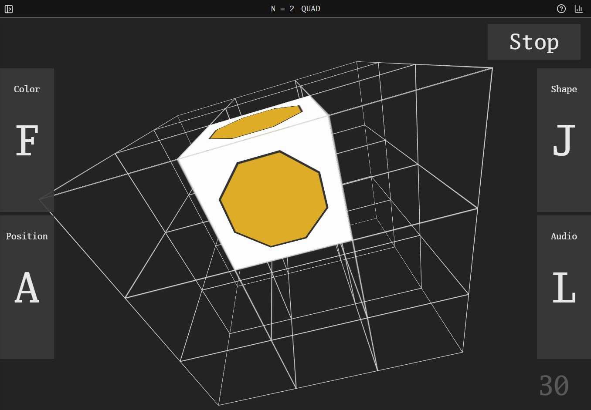

> **In Chimera Hub.** Imported from [soamsy/quad-box](https://github.com/soamsy/quad-box)
> at `a6cda73`, MIT (see LICENSE), for the hub's beginner's shelf and its
> N-back folder. Changes made here: its IndexedDB database is `QuadBoxClassic`
> and its settings key `quad-box-classic-settings`, not `QuadBoxNBack` and
> `quad-box-settings`, because N-back Constant Change (`../quadbox`), a variant
> of this app with its own history, runs on the same origin under those names;
> and the touch icon points at `assets/icons/`, where the icons are.

# Quad Box

3D Quad N-back



Play at https://quad-box.netlify.app

# Development
```
npm install
npm run dev
```


To view available shapes:
```
npm run view-shapes
```